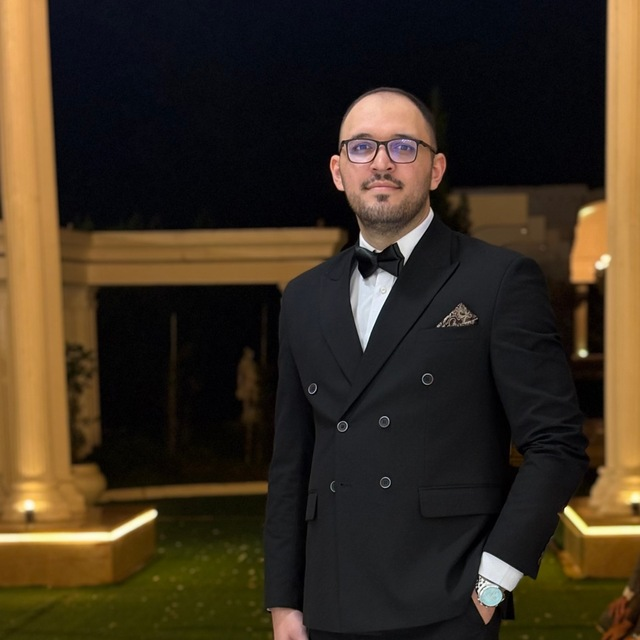

  
  <h1>Mohammad Hosein (Cena) Ashoori</h1>
  
<strong>Software Engineer · Full-Stack Product Builder · Researcher</strong>

  
Taking thoughtful applications from first idea to polished production.

## About

I build software end to end: shaping product flows, designing and implementing the interface, developing backend services and APIs, and taking the application through deployment and ongoing iteration. My current work spans digital health, AI-assisted fashion, and software engineering research.

## Selected work

- **[DocSphere](https://docsphere.app/)** — a digital health product with connected care and service workflows.
- **[Wearto](https://wearto.app/)** — an AI-assisted fashion and commerce experience across web and mobile, including virtual try-on.

## Research

- **Community detection method based on random walk and multi-objective evolutionary algorithm in complex networks** — *Journal of Network and Computer Applications*, 234, 104070 (2025). [DOI](https://doi.org/10.1016/j.jnca.2024.104070)
- **Refactoring detection across languages: Leveraging Java-trained models for detecting class-level refactorings in Kotlin** — *SEAA 2025*, Lecture Notes in Computer Science 16081, 46–63. [DOI](https://doi.org/10.1007/978-3-032-04190-6_4)

More details: [publications](https://cenaashoori.github.io/publications/) · [Google Scholar](https://scholar.google.com/citations?user=eBNZsM0AAAAJ) · [ORCID](https://orcid.org/0000-0001-9443-0949)

## Toolkit

**Frontend:** React, Next.js, TypeScript  
**Backend:** Python, Django, FastAPI  
**Product delivery:** UX flows, API design, integrations, deployment, and production iteration

## Contact

[Website](https://cenaashoori.github.io/) · [LinkedIn](https://www.linkedin.com/in/mhashoori/) · [Email](mailto:mhashoori.edu@gmail.com)
